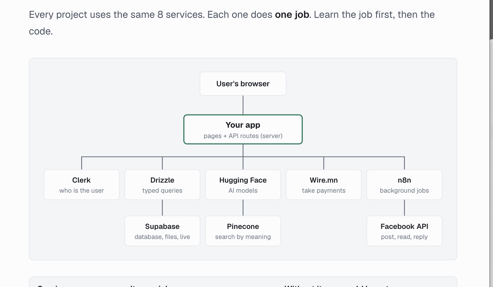

# Архитектур: 8 сервис, тус бүр нэг үүрэгтэй



```
User's browser
      │
   Your app  (pages + API routes, server)
      │
  ┌───────┬──────────┬──────────────┬─────────┬──────────┐
Clerk   Drizzle   Hugging Face    Wire.mn    n8n
  │        │           │                       │
       Supabase     Pinecone             Facebook API
```

## Явцын хяналт

> Өдөр бүрийн devlog бичихдээ энэ хүснэгтийг шалгаж, шинэчилнэ.

| # | Сервис | Үүрэг | HybridBat-д юунд | Төлөв | Огноо |
|---|---|---|---|---|---|
| 1 | **Your app** (Next.js) | pages + API routes | Нүүр, `/models/[slug]` | 🟡 Хэсэгчлэн — `/listings`, `/listings/[id]`, `/listings/new`, `/sign-in` байхгүй; API route алга | 2026-11-16 |
| 2 | **Drizzle** | typed queries | `lib/db/schema.ts`, `lib/listings.ts` | ✅ `listings` хүснэгт, migration, query | 2026-11-17 |
| 3 | **Supabase** | database, files, live | Postgres (Сингапур pooler) | 🟡 DB ✅ · Storage (зарын зураг) ⬜ · Realtime ⬜ | 2026-11-17 |
| 4 | **Clerk** | who is the user | Нэвтрэх, "Зар нэмэх", `listings.user_id` | ⬜ Эхлээгүй | |
| 5 | **n8n** | background jobs | Шинэ зарыг Page руу автоматаар нийтлэх | ⬜ Эхлээгүй | |
| 6 | **Facebook API** | post, read, reply | Өөрийн Page руу нийтлэх (бусдын групп/Marketplace-аас татахгүй) | ⬜ Эхлээгүй | |
| 7 | **Wire.mn** | take payments | Жишээ нь: зар онцлох (featured), зарлагчийн багц | ⬜ Эхлээгүй | |
| 8 | **Hugging Face** | AI models | Жишээ нь: зарын тайлбар боловсруулах, загвар таних | ⬜ Эхлээгүй | |
| 9 | **Pinecone** | search by meaning | "Prius-ийн батерей хурдан дуусдаг" гэх мэт утгаар хайх | ⬜ Эхлээгүй | |

Тэмдэглэгээ: ✅ дууссан · 🟡 хэсэгчлэн · ⬜ эхлээгүй

## Дараалал (санал)

1. ~~Supabase + Drizzle~~ ✅
2. **Clerk** → "Зар нэмэх" форм (Server Action → `listings`)
3. `/listings`, `/listings/[id]` хуудсууд + Supabase Storage (зарын зураг)
4. **n8n + Facebook API** → зарыг Page руу нийтлэх
5. **Wire.mn** → төлбөртэй онцлох зар
6. **Hugging Face + Pinecone** → утгаар хайх
